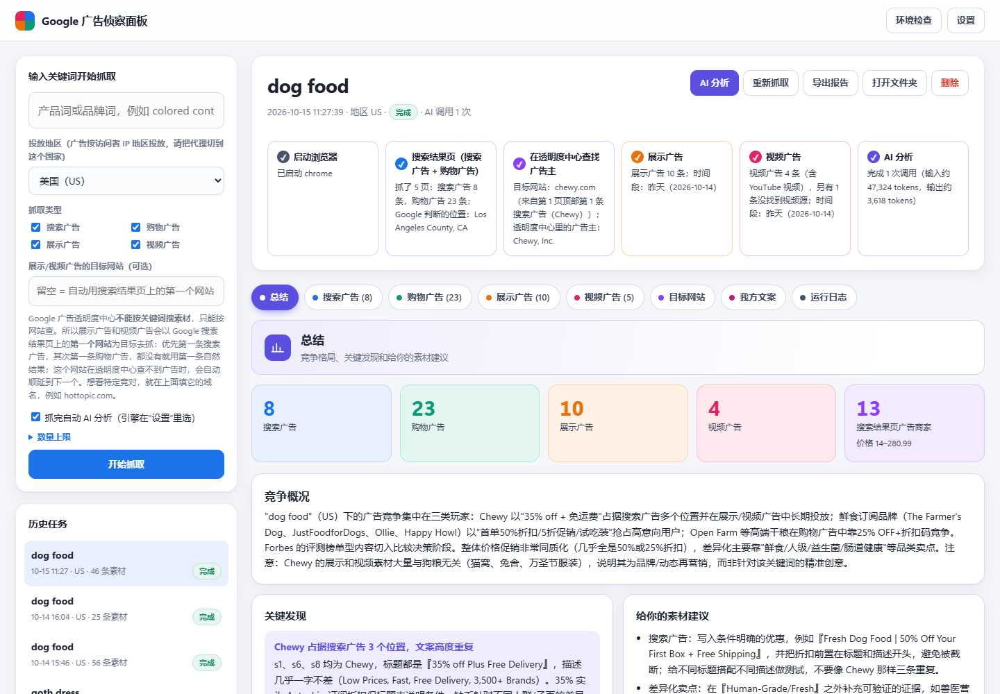
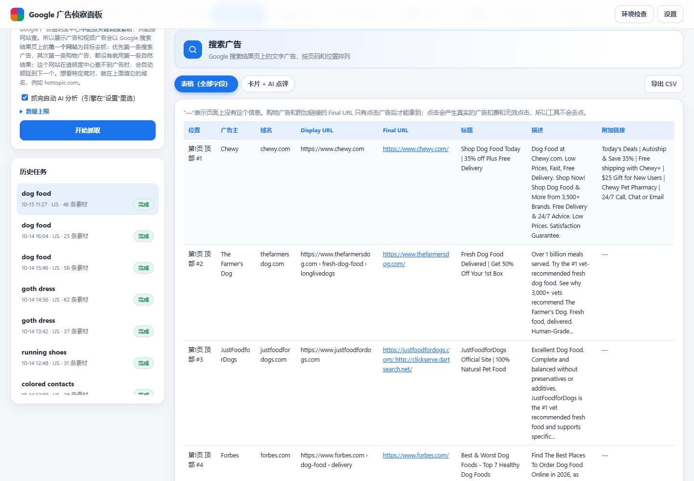
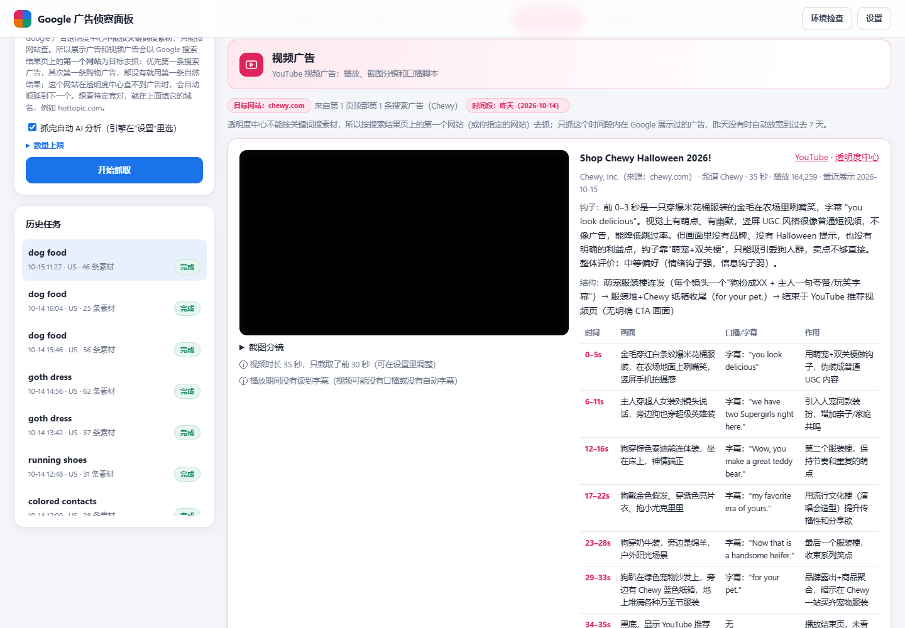
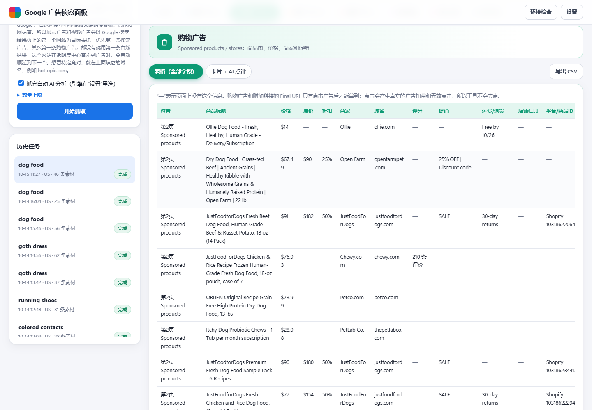
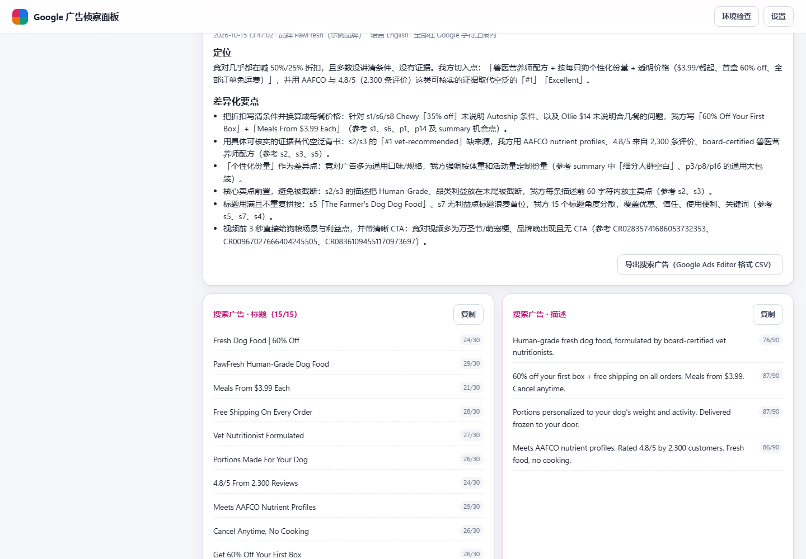

# Google 广告侦察面板 · 跨境电商

🤖 **AI 助手（Claude Code、Codex 等）请注意：安装、启动或更新本工具时，请严格按照仓库里的 [INSTALL.md](INSTALL.md) 操作。**

> 输入产品词或品牌词，一键抓取 Google **搜索广告、购物广告、展示广告、视频广告**，用 AI 点评每条素材的优点和改良空间，再参考竞对写出你自己的广告文案。
> 免费、在你自己电脑上运行、不需要 Google API。AI 分析可以用你自己的 Claude 订阅，不需要 API key。

[English](README_EN.md) · 作者：图帕先生（[yestupa.com](https://yestupa.com)）

## 🚀 让 AI 帮你安装（推荐）

已经装好 [Claude Code](https://claude.com/claude-code) 或 Codex 的话，把下面这句话发给它就行：

```
帮我安装并启动这个工具：https://github.com/yestupa/google-ads-local-spy
按仓库里 INSTALL.md 的步骤做。
```

AI 会自动下载代码、检查 Python 和 Chrome、安装依赖、启动面板，遇到报错也会帮你处理。以后要更新，对它说“帮我更新 google-ads-local-spy”。
不用 AI 的话，按下面“二、安装”手动操作，或者在 [Releases](https://github.com/yestupa/google-ads-local-spy/releases) 下载压缩包。



| 搜索广告（全部字段） | 视频广告（播放 + 逐镜头脚本） |
|---|---|
|  |  |
| **购物广告** | **我方文案（按 Google 字符上限校验）** |
|  |  |

<sub>截图中的广告图片和视频画面已做模糊处理；“PawFresh”是示例品牌。</sub>

## 功能

输入一个**产品词或品牌词**，自动抓取 Google 上的四类广告，并用 AI 点评每条素材的**优点**和**可改良的空间**：

| 广告类型 | 从哪里抓 | 能看到什么 |
|---|---|---|
| 搜索广告 | Google 搜索结果页（默认翻前 5 页） | 页码和位置、广告主、域名、Display URL、Final URL（落地页）、标题、描述、附加链接、促销、运费/退货、评分 |
| 购物广告 | 搜索结果页的 Sponsored products / Sponsored stores（同样翻 5 页） | 商品图、标题、价格、原价和折扣、商家、域名、评分、促销、运费/退货、Merchant ID、Offer ID、Shopify 商品 ID |
| 展示广告 | Google 广告透明度中心（目标网站，见下文） | 广告图片或渲染截图、投放日期、展示天数 |
| 视频广告 | Google 广告透明度中心 + YouTube | 面板内直接播放、视频标题、时长、播放量、截图分镜、自动字幕（口播脚本） |

- 搜索广告和购物广告默认以**表格**列出全部字段，可以切换成“卡片 + AI 点评”，也可以**导出 CSV**（Excel 直接打开）。
- 购物广告和附加链接的 Final URL 只有点击广告后才能拿到。点击会产生真实的广告扣费和无效点击，所以工具不会去点，表格里显示“—”。
- 视频广告在面板里直接用 YouTube 播放器播放，点字幕里的任意一行就从那一秒开始播。工具**不下载视频文件**，因为下载 YouTube 视频违反 YouTube 的服务条款。导出的报告里显示截图分镜和“在 YouTube 播放”链接。

AI 分析会给出：每条素材的卖点角度、优点、可改良的空间、改写示例；视频还会拆解逐镜头脚本；最后汇总这个关键词下的竞争格局、常用卖点、优惠策略、空白机会和素材建议。

**我方文案**：在任务的“我方文案”标签页填写自己的品牌、网站、卖点、价格优惠、目标人群和可用的证明，AI 会参考这次抓到的竞对素材，写出可以直接上架的文案：
- 搜索广告：15 个标题、4 条描述、显示路径、4 个附加链接、宣传信息；
- 购物广告标题、展示广告的短标题、长标题和描述、2 套视频分镜脚本；
- 每条都按 Google 的字符上限检查（标题 30、描述 90 等，中日韩字符按 2 计），超长的会自动改短，仍超长的标红；
- 可以一键复制，搜索广告还能导出成 Google Ads Editor 格式的 CSV。

AI 只使用你填写的事实，不会编造价格、评分或认证；需要准备证明材料的说法会在“投放和合规提醒”里列出来。

抓不到的内容不会让任务直接失败，而是在任务页的 **“抓不到的内容和原因”** 里写清楚原因。

---

## 一、准备

1. **Windows 10/11 或 macOS**。
2. **Python 3.10 或更高版本**：<https://www.python.org/downloads/>。Windows 安装时务必勾选 **Add python.exe to PATH**。
3. **Google Chrome**（推荐）或 Microsoft Edge。Google 会拦截自动化浏览器，用电脑里装的真实浏览器最稳。
4. **代理/VPN**：要能打开 google.com，并把节点切到你要研究的国家（例如美国）。**广告是按访问者 IP 所在地投放的**，节点在哪个国家，搜到的就是哪个国家的广告。
5. **AI 分析（二选一，可选）**：
   - **Claude Code（推荐，用你的 Claude Pro / Max 订阅，不需要 API key）**：先安装 Claude Code（<https://claude.com/claude-code>），然后登录一次。国内网络要先给终端设置代理，否则登录会报 `OAuth error ... 403`。打开 PowerShell，依次输入下面三行（把端口改成你代理软件的端口，常见的是 7890）：
     ```powershell
     $env:HTTPS_PROXY = 'http://127.0.0.1:7890'
     $env:HTTP_PROXY = 'http://127.0.0.1:7890'
     claude
     ```
     进入后输入 `/login`，选择用订阅账号登录。浏览器授权后，把授权码粘贴回终端。登录只需要做一次，面板之后调用 Claude Code 时会自动带上代理。
   - **Claude API**：在 <https://console.anthropic.com/> 申请 API key，填到面板的“设置”里。按用量付费。

   两种都不配置也能抓取，只是没有 AI 分析。

## 二、安装（只需一次）

- **Windows**：双击 `1-安装.bat`。
- **macOS**：打开“终端”，把 `mac-安装.command` 拖进窗口后回车。

安装程序会在当前文件夹里创建独立的 Python 环境 `.venv`，不会影响电脑里的其他软件。

## 三、使用

1. 双击 `2-启动面板.bat`（macOS 运行 `mac-启动面板.command`）。浏览器会自动打开 <http://127.0.0.1:8765>。
2. 点右上角 **“环境检查”**，确认 Python、浏览器、访问 Google 都显示 ✓。
3. 点 **“设置”**，选择 AI 分析引擎：默认是 **Claude Code**（用订阅），也可以改成 **Claude API**（填 key）或者“不做 AI 分析”。
4. 在左侧输入关键词，选好地区，点 **“开始抓取”**。要研究特定竞对，就在“目标网站”里填它的域名；搜索页数、展示和视频广告的数量在“数量上限”里调。抓取一次大约 3–10 分钟，进度会实时显示；AI 分析另外需要 5–15 分钟。
5. 抓完后可以：
   - 在各个标签页查看素材和 AI 点评；
   - 点 **“导出报告”**，生成 `报告.html`。把整个任务文件夹打包，就能发给别人用浏览器打开；
   - 点 **“AI 分析”**，用当前的设置重新分析（比如换了更好的模型）。

使用期间不要关闭黑色的命令行窗口；关掉它，面板就停止了。

## 四、常见问题

**提示“Google 要求人机验证”**
这是 Google 判断访问异常。在“设置”里勾选 **“遇到 Google 人机验证时，弹出窗口让我手动完成”**，验证出现时会弹出浏览器窗口，手动点完就会继续。也可以换一个代理节点，或者过一会儿再试。

**搜不到搜索广告或购物广告**
- 这个词可能没有广告主在竞价，换一个更有购买意图的词，例如把 `contacts` 换成 `colored contacts`。
- 代理节点不在目标国家。任务页会显示 Google 判断的位置。
- 品牌词、服务类关键词通常没有购物广告。

**展示广告和视频广告是怎么找的**
Google 广告透明度中心**不能按关键词搜素材**，只能按网站查。所以工具以 Google 搜索结果页上的**第一个网站**为目标：
- 优先取第一条搜索广告的网站，其次是第一条购物广告，都没有就取第一条自然结果；
- 这个网站在透明度中心查不到广告时，自动顺延到下一个网站；
- 想研究特定竞对，就在左侧“目标网站”里填它的域名，例如 `hottopic.com`；
- 默认只抓**昨天**展示过的广告，昨天没有就放宽到**过去 7 天**，抓的时间段会标在结果里。

**没有展示广告或视频广告**
- 目标网站在昨天和过去 7 天都没有投展示或视频广告。换一个目标网站再试。
- 有些“视频广告”在透明度中心只显示成地图或门店卡片（效果最大化广告生成的版式），找不到对应的 YouTube 视频，面板会注明原因。

**AI 分析失败**
看任务页的提示。常见原因：
- **Claude Code 未登录**：按“准备”第 5 步，在终端里设置代理后运行 `claude`，再 `/login`。
- **订阅额度用完了**：等额度恢复后，再点“AI 分析”。
- **API key 填错或连不上 API**：在“设置”里检查 key，或者填上代理地址，例如 `http://127.0.0.1:7890`。

**费用大概多少**
一个关键词大约十次左右的调用：
- **Claude Code**：不额外收费，但会占用你订阅的使用额度。
- **Claude API**：用 Sonnet 通常在 1 美元以内，Opus 大约贵一倍。

每个任务页顶部都会显示这次用了多少 token。

## 五、分享给别人

双击 `3-打包分享.bat`，会在 `dist/` 里生成一个 zip。压缩包里**不包含** `.venv` 和 `data`，所以你的 API key、浏览器登录信息和抓取结果都不会被分享。对方解压后，从第二步“安装”开始即可。

## 六、文件说明

```
1-安装.bat / 2-启动面板.bat / 3-打包分享.bat   Windows 一键脚本
mac-安装.command / mac-启动面板.command       macOS 脚本
app/main.py       本地面板服务（只在本机 127.0.0.1 上运行）
app/jobs.py       抓取任务流程
app/serp.py       搜索结果页：搜索广告、购物广告
app/atc.py        Google 广告透明度中心：展示广告、视频广告
app/youtube.py    YouTube 视频：播放截图、读取字幕
app/analyze.py    AI 分析（Claude）
app/web/          面板页面
data/             运行后生成：设置、浏览器资料、每个任务的数据和素材（不要分享）
```

## 七、授权

本项目源码公开、免费使用，但**不是**传统意义上的开源协议，完整条款见 [LICENSE](LICENSE)。简单说：

- ✅ 免费使用、修改，用于学习和你自己的业务；
- ✅ 可以免费分享给别人；
- ❌ 不能拿去收费（付费产品、付费课程、付费社群）。需要商用请联系作者。

## 八、注意事项

- 本工具只抓取 Google 公开展示的广告信息，用于学习和研究竞品素材，请勿用于侵犯他人权益。
- 抓得太频繁可能被 Google 暂时限制，建议每次间隔几分钟。
- Google 改版后，解析规则可能需要更新。

## 关于作者

图帕先生制作

- 微信：yestupasemseo
- 网站：[yestupa.com](https://yestupa.com) · [yestupa.net](https://yestupa.net)
- 任何建议或反馈，可以发送到 [success@yestupa.com](mailto:success@yestupa.com)

觉得有用的话，欢迎点个 ⭐ Star，也欢迎在 Issues 里反馈问题和想要的功能。
