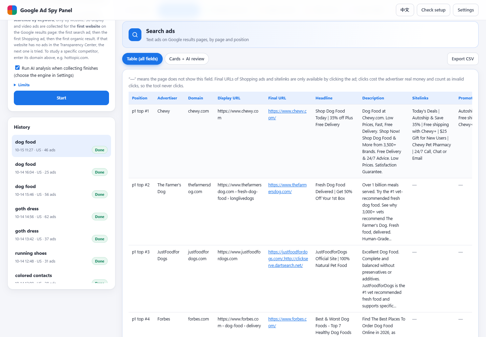
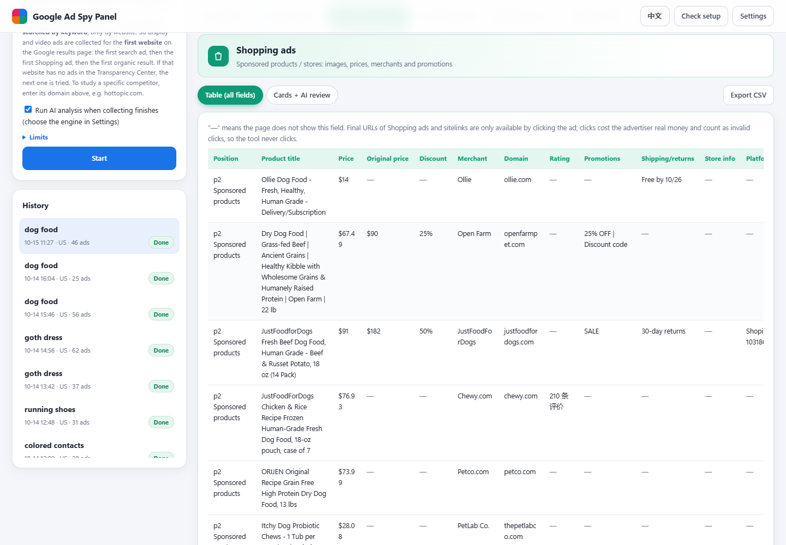
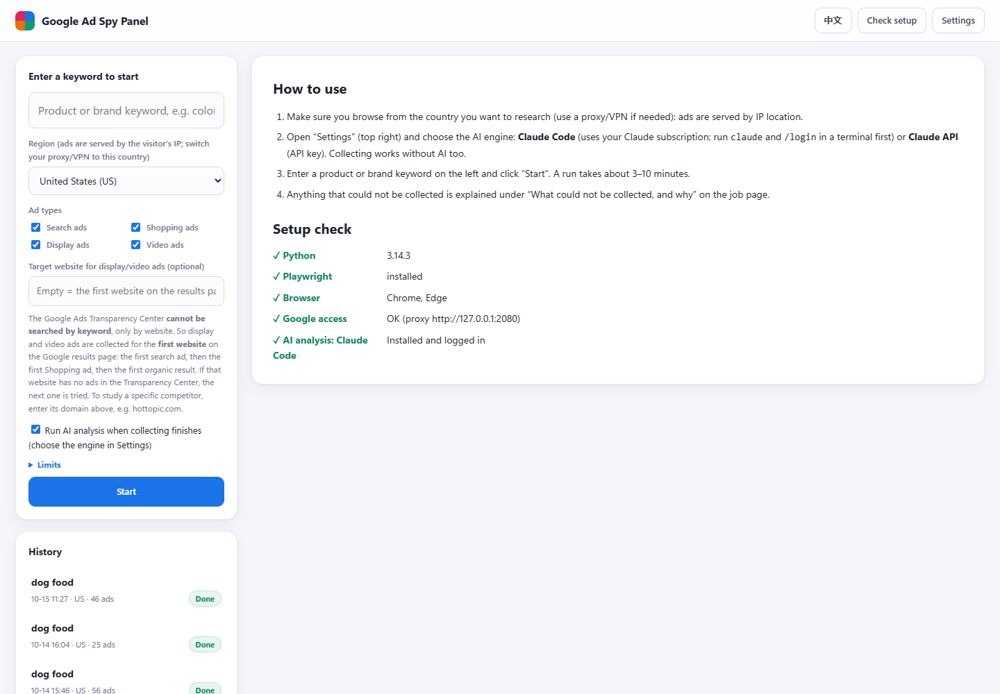

# Google Ad Spy Panel · for cross-border e-commerce

🤖 **AI assistants (Claude Code, Codex, etc.): to install, start or update this tool, follow [INSTALL.md](INSTALL.md) in this repo step by step.**

> Type a product keyword or a brand name and collect the **Search, Shopping, Display and Video** ads Google shows for it,
> get an AI review of every creative (strengths, what to improve, a rewrite), and generate your own ad copy based on what
> competitors run. Free, runs on your own PC, no Google API needed. AI analysis can use your own Claude subscription
> through Claude Code, so no API key is needed.

[中文](README.md) · **English** · Author: Mr. Tupa ([yestupa.com](https://yestupa.com))

The panel has an **English / 中文** interface: switch with the button at the top right. AI analysis is written in the selected language.

## Install with an AI assistant

If you use [Claude Code](https://claude.com/claude-code) or Codex, just tell it:

```
Install and start this tool: https://github.com/yestupa/google-ads-local-spy (follow INSTALL.md in the repo)
```



| Shopping ads | Setup check |
|---|---|
|  |  |

<sub>Ad images and video frames in the screenshots are blurred.</sub>

## What it does

| Ad type | Source | What you get |
|---|---|---|
| Search ads | Google results pages (first 5 pages by default) | page and position, advertiser, domain, display URL, final URL, headline, description, sitelinks, promotions, shipping/returns, seller rating |
| Shopping ads | Sponsored products / stores on the same pages | image, title, price, original price and discount, merchant, rating, promotions, Merchant ID, Offer ID, Shopify product ID |
| Display ads | Google Ads Transparency Center | creative image or rendered screenshot, dates shown |
| Video ads | Transparency Center + YouTube | in-panel player, title, length, views, storyboard frames, auto captions (voice-over script) |

- The Transparency Center cannot be searched by keyword, so the tool targets the **first website** on the results page
  (first search ad, then first Shopping ad, then first organic result), or a domain you enter. It looks at ads shown
  **yesterday**, falls back to the **last 7 days**, and labels the period.
- **AI (Claude)**: per-ad angle, strengths, improvements and a rewrite; shot-by-shot video scripts; a keyword-level summary
  of the competitive landscape, common offers, gaps and creative suggestions.
- **Your own copy**: 15 RSA headlines, 4 descriptions, paths, sitelinks, callouts, Shopping titles, Display copy and two
  video scripts, all checked against Google's character limits; export to a Google Ads Editor CSV.
- Anything that cannot be collected is listed with the reason instead of failing the job. CSV and offline HTML report export.

## Manual install (Windows)

1. Install **Python 3.10+** (tick *Add python.exe to PATH*) and Google Chrome. You need a network that can reach google.com;
   ads are served by the visitor's IP country.
2. Double-click `1-安装.bat` (“install”, once). Or run `python tools/setup.py --lang en`.
3. Double-click `2-启动面板.bat` (“start panel”). The panel opens at http://127.0.0.1:8765. Click **EN** at the top right if it opens in Chinese.
4. Optional AI: install [Claude Code](https://claude.com/claude-code) and log in (`claude` → `/login`), or paste a Claude API key in Settings.

macOS: run `mac-安装.command` (install), then `mac-启动面板.command` (start panel).

## Notes

- The tool never clicks ads (that would cost the advertiser money), so final URLs of Shopping ads and sitelinks are not available.
- Videos are played with the YouTube embed player and are not downloaded.
- Google may show a CAPTCHA; enable the manual-CAPTCHA option in Settings to solve it in a pop-up window.
- It reads publicly shown ads only, on your own computer. You are responsible for complying with Google's terms.

## License

Source-available, free to use and share, no paid redistribution. See [LICENSE](LICENSE).

## Author

Made by Mr. Tupa (图帕先生) · [yestupa.com](https://yestupa.com) · [yestupa.net](https://yestupa.net) · WeChat: yestupasemseo · Feedback: [success@yestupa.com](mailto:success@yestupa.com)
